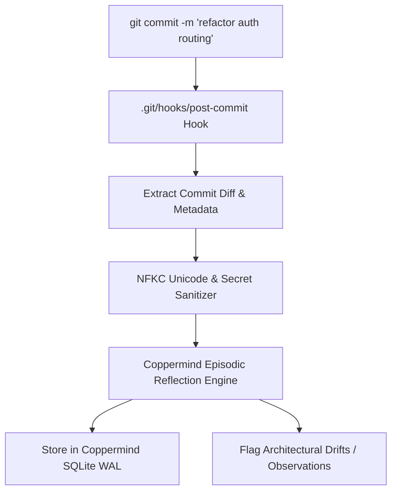

# Recipe: Automated Post-Commit Episodic Reflection

> **Use Case ID:** `COP-UC-02`  
> **Target Audience:** Developers, Lead Architects, Autonomous Agent Supervisors  
> **Platform Engine:** Git Post-Commit Hook & Episodic Synthesizer  

---

## 1. Problem Statement

Codebases drift away from their original architectural designs over time. Developers and AI agents merge quick bugfixes, introduce new dependencies, or alter API contracts without documenting the rationale. Weeks later, nobody remembers *why* a particular change was introduced.

---

## 2. When to Use This

Use **Coppermind Git Hook Reflection** to automatically synthesize architectural memory from every commit. Installing the hook takes one command (`coppermind hook install`). On every `git commit`, Coppermind:
1. Extracts the commit diff.
2. Sanitizes sensitive tokens (passwords, keys).
3. Synthesizes an episodic architectural reflection.
4. Detects potential specification drift or security risks as open "observations".

---

## 3. Architecture & Dataflow



---

## 4. Prerequisites

1. **Coppermind CLI:** Available on `$PATH`.
2. **Git Repository:** Initialized local git repository.

---

## 5. Step-by-Step Recipe

### Step 1: Install Post-Commit Hook
In your project repository:
```bash
coppermind hook install
```
Output:
```text
✅ Coppermind post-commit hook successfully installed to .git/hooks/post-commit.
```

### Step 2: Make Code Edits and Commit Normally
```bash
git add .
git commit -m "feat(auth): add rate limiting to login endpoint"
```
The hook executes asynchronously in the background in under 20ms without stalling your shell.

### Step 3: Review Generated Observations
```bash
coppermind observations --status open
```
Expected output:
```text
🔍 Coppermind Active Observations:
[OBS-01] Commit 4c3bd5e: Rate limiter introduces in-memory map without TTL eviction.
         Severity: MEDIUM | Status: OPEN | Suggested Remediation: Use sync.Map or LRU cache.
```

---

## 6. Verification & Expected Output

Verify hook health:
```bash
coppermind hook status
```
Outputs hook installation path, last execution timestamp, and total diffs processed.

---

## 7. Security Invariants & Blast Radius

- **Zero-Block Shell:** The hook runs as a detached background job (`nohup` / `&`); a slow reflection never delays git operations.
- **Secret Scrubbing:** All diffs are filtered through Shield's redaction patterns before memory ingestion.

---

## 8. Troubleshooting & Common Pitfalls

- **Issue:** Hook not running after `coppermind hook install`.  
  **Remediation:** Check executable bit on `.git/hooks/post-commit`:
  ```bash
  chmod +x .git/hooks/post-commit
  ```
