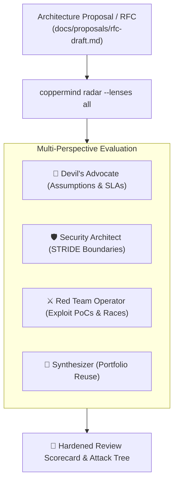

# Recipe: Multi-Perspective Analytical Threat Lenses

> **Use Case ID:** `COP-UC-03`  
> **Target Audience:** Systems Architects, Red Team Operators, Product Owners  
> **Platform Engine:** Cognitive Analytical Lenses Engine  

---

## 1. Problem Statement

Engineering teams evaluating complex architecture proposals or RFCs often suffer from confirmation bias. Subtle failure modes, unstated assumptions, single points of failure (SPoFs), and exploit vectors (sandbox escapes, TOCTOU races) are overlooked until code is already in production.

---

## 2. When to Use This

Use **Coppermind Threat Lenses** to stress-test raw ideas, RFC documents, or PR descriptions before writing code. Coppermind runs automated multi-persona cognitive evaluations:
- **`devils-advocate`**: Interrogates unstated assumptions and fragility.
- **`security-architect`**: Authors STRIDE threat models and privilege boundary checks.
- **`red-team-operator` (*Shardbreaker*)**: Mounts offensive exploit synthesis, generating attack trees and sandbox escape PoCs.
- **`synthesizer`**: Detects portfolio reuse and flags redundant code.

---

## 3. Architecture & Dataflow



---

## 4. Prerequisites

1. **Coppermind Installed:** Version 1.0+ on `$PATH`.
2. **Local Model / Provider:** Configured in `~/.coppermind/config.yaml`.

---

## 5. Step-by-Step Recipe

### Step 1: Run Multi-Perspective Evaluation on a Document
```bash
coppermind radar --lenses security-architect,red-team-operator --file ./docs/proposals/my-rfc.md
```

### Step 2: Review Findings and Attack Trees
Expected output:
```text
🔍 Coppermind Cognitive Lens Report:
[Lens: Security Architect]
  • STRIDE (Elevation of Privilege): Flagged potential TOCTOU race in /tmp file creation.
  • Compliance: Safe Harbor verified (100% local, no enterprise cloud control plane).

[Lens: Red Team Operator (Shardbreaker)]
  • Attack Vector: Attacker can manipulate symlinks in /tmp to overwrite ~/.ssh/authorized_keys.
  • Recommendation: Use O_NOFOLLOW and 0700 private directories.
```

---

## 6. Verification & Expected Output

Verify that findings are automatically recorded as review proposals:
```bash
coppermind proposals --status pending
```

---

## 7. Security Invariants & Blast Radius

- **Read-Only Evaluation:** Running lenses never mutates the underlying codebase or executes proposed commands.

---

## 8. Troubleshooting & Common Pitfalls

- **Issue:** Lens query fails with missing API key.  
  **Remediation:** Configure provider credentials via Locksmith or local config:
  ```bash
  export GEMINI_API_KEY=$(locksmith get GEMINI_API_KEY)
  ```
