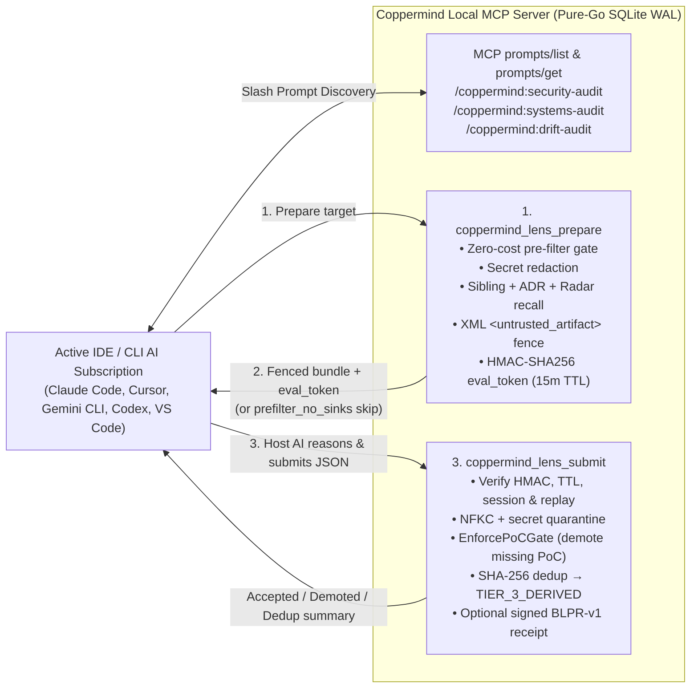

# Recipe: Zero-API-Key Host-Evaluated Cognitive Lenses

> **Use Case ID:** `COP-UC-03C`  
> **Target Audience:** Individual Developers, Security Engineers, Systems Architects  
> **Platform Engine:** MCP Host-Evaluated Lens Handoff (`coppermind_lens_prepare` → `coppermind_lens_submit`) & MCP `prompts/*`

---

## 1. Problem Statement

Traditional cognitive lenses require either a separate metered LLM API key (`OPENAI_API_KEY`, `ANTHROPIC_API_KEY`, `GEMINI_API_KEY`) or 4–16 GB of local RAM/VRAM running Ollama. Yet most developers are **already authenticated** to a frontier reasoning model inside Claude Code, Cursor, Gemini CLI, OpenAI Codex CLI, or VS Code Copilot through their existing subscription.

Coppermind's **Zero-API-Key Host-Evaluated Lenses** let your active AI coding session perform the lens reasoning directly while keeping **100% of security invariants deterministic inside Go**—with zero extra API keys, zero local Ollama overhead, and zero interactive MCP sampling modal popups.

---

## 2. When to Use This

Use zero-API-key host-evaluated lenses when you want:
- **Differential security threat modeling** (`/coppermind:security-audit`) that compares a modified route or handler against sibling endpoints, stored ADRs, and industry radar facts.
- **Systems & concurrency architecture review** (`/coppermind:systems-audit`) auditing Hop-Tax overhead, $N=8$ multi-agent contention, and subsystem boundary leaks.
- **ADR & convention drift detection** (`/coppermind:drift-audit`) comparing code or docs against `TIER_0`/`TIER_1` memories.
- **Zero extra billing or model management**, using the AI assistant subscription already running in your IDE or CLI.

---

## 3. Architecture & Dataflow



---

## 4. Prerequisites

1. **Coppermind Installed:** Pure-Go `coppermind` binary on `$PATH`.
2. **MCP Configured in Your AI Client:** Add Coppermind to your IDE's MCP config (zero extra API key environment variables required):
   ```json
   {
     "mcpServers": {
       "coppermind": {
         "command": "coppermind",
         "args": ["mcp"]
       }
     }
   }
   ```

---

## 5. Step-by-Step Recipe

### Option A: One-Click MCP Slash Prompts (Fastest)

Coppermind advertises `capabilities.prompts` during MCP `initialize` and exposes three canonical prompts via `prompts/list` and `prompts/get`:

| Slash Prompt | Backing Lens | Primary Audit Focus |
| :--- | :--- | :--- |
| `/coppermind:security-audit` | `security-architect` | 3-step differential auth check, sibling comparison, executable PoC gate |
| `/coppermind:systems-audit` | `systems-architect` | Hop-Tax latency, $N=8$ concurrency contention, layer/boundary leaks |
| `/coppermind:drift-audit` | `drift-auditor` | Contradictions against stored `TIER_0`/`TIER_1` ADRs and conventions |

Each prompt accepts optional arguments (`target_id`, `file_path`, `content`, `project`). Invoke it directly in your IDE chat:
```text
/coppermind:security-audit file_path="pkg/api/delete_item.go"
```

### Option B: Explicit Two-Step MCP Handoff (`coppermind_lens_prepare` → `coppermind_lens_submit`)

#### Step 1: Prepare the Fenced Bundle
Your AI assistant calls `coppermind_lens_prepare`:
```json
{
  "name": "coppermind_lens_prepare",
  "arguments": {
    "lens": "security-architect",
    "file_path": "pkg/api/delete_item.go",
    "content": "func (h *ItemHandler) DeleteItemHandler(w http.ResponseWriter, r *http.Request) { deleteItem(r.URL.Query().Get(\"id\")) }",
    "session_id": "sess_01JDEVLOCAL"
  }
}
```
* If the code contains no sensitive sinks (and `force` is `false`), Coppermind returns `{"skipped": true, "skip_reason": "prefilter_no_sinks"}`, saving **100% of host LLM tokens**.
* Otherwise, Coppermind redacts any embedded credentials, recalls sibling endpoints (`<sibling_endpoints>`), project ADRs (`<recalled_context>`), and threat advisories (`<industry_radar_baseline>`), fences the candidate inside `<untrusted_artifact>`, and returns a single-use `eval_token`.

#### Step 2: Host AI Evaluates & Submits Strict JSON Findings
Using its existing subscription, the active IDE model evaluates the fenced prompt and calls `coppermind_lens_submit`:
```json
{
  "name": "coppermind_lens_submit",
  "arguments": {
    "eval_token": "cmlens1.<payload>.<hmac>",
    "session_id": "sess_01JDEVLOCAL",
    "emit_receipt": true,
    "findings_json": {
      "findings": [
        {
          "severity": "high",
          "category": "differential_auth",
          "entry_point": "DeleteItemHandler",
          "sibling_inconsistency": "GetItemHandler calls verifyTenant(r); DeleteItemHandler omits it",
          "summary": "Cross-tenant IDOR deletion on DeleteItemHandler",
          "poc": "curl -X DELETE http://localhost:8080/items?id=victim-1"
        }
      ]
    }
  }
}
```

---

## 6. Verification & Expected Output

`coppermind_lens_submit` returns a deterministic JSON summary:
```json
{
  "lens": "security-architect",
  "accepted_count": 1,
  "demoted_no_poc_count": 0,
  "deduplicated_count": 0,
  "receipt_id": "rcpt_8f2a9c..."
}
```

Inspect persisted derived observations from the CLI at any time:
```bash
coppermind observations --status open --min-severity high
```

---

## 7. Security Invariants & Blast Radius

Even if untrusted code inside `<untrusted_artifact>` attempts indirect prompt injection against the host AI model, deterministic Go code inside `coppermind_lens_submit` enforces:
1. **Single-Use Cryptographic Token Binding (`eval_token`):** Signed with a per-process 256-bit CSPRNG HMAC-SHA256 key (`hmac.Equal`), 15-minute TTL, bound to `(project, lens, target_sha256, session_id)`, and tracked in a 16-shard lock-striped replay cache for zero contention across $N=8$ parallel subagents. Forged, expired, mismatched, or replayed tokens fail closed with `UB-MCP-v1` `exit_code: 10` (`COPPERMIND_EVAL_TOKEN_DENY`).
2. **Pre-Prompt & Post-Submit Secret Quarantine:** Raw private keys and API credentials are redacted before leaving `coppermind_lens_prepare` and quarantined again in `coppermind_lens_submit` before reaching SQLite.
3. **Deterministic PoC Gate (`EnforcePoCGate`):** Any `medium`, `high`, or `critical` security finding lacking an actionable, executable reproduction command/payload is automatically demoted to `info` (`unverified_poc: true`).
4. **Epistemic Ceiling & Loop Prevention:** Submitted observations are stored strictly with `derived: true` and `authority_tier: "TIER_3_DERIVED"`, can never overwrite `TIER_0`/`TIER_1` invariants, never trigger recursive re-indexing, and deduplicate idempotently via `SHA256(project:lens:target_sha256:summary)`.

---

## 8. Troubleshooting & Common Pitfalls

- **Issue:** `coppermind_lens_prepare` returned `{"skipped": true, "skip_reason": "prefilter_no_sinks"}` on code you still want audited.  
  **Remediation:** Pass `"force": true` in `coppermind_lens_prepare` (or pass inline `content` via `/coppermind:security-audit`, which sets `force: true` automatically).
- **Issue:** `coppermind_lens_submit` returned `COPPERMIND_EVAL_TOKEN_DENY` (`exit_code: 10`).  
  **Remediation:** Tokens expire after 15 minutes, are single-use, and require matching `session_id` when session-bound. Call `coppermind_lens_prepare` to mint a fresh `eval_token`.
- **Issue:** A `critical` finding was stored as `info` (`demoted_no_poc_count: 1`).  
  **Remediation:** Provide a concrete, reproducible command or payload (`curl`, HTTP request, JSON payload, or invocation snippet) in the `poc` field so `EnforcePoCGate` verifies exploitability.
