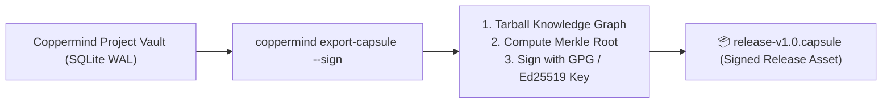

# Recipe: Exporting Signed Knowledge Capsules

> **Use Case ID:** `COP-UC-04`  
> **Target Audience:** Release Managers, Open Source Contributors, Compliance Officers  
> **Platform Engine:** Immutable Knowledge Capsule Export Engine  

---

## 1. Problem Statement

When releasing open-source software or handing off code to external teams, the repository's historical context, ADR decisions, and security audit records are trapped inside local databases. Packaging this institutional memory with the release tag ensures future contributors understand why the software was designed that way.

---

## 2. When to Use This

Use **`coppermind export-capsule`** during release packaging. Coppermind compiles all project memories, architecture invariants, and observation logs into a compressed, cryptographically signed `.capsule` archive.

---

## 3. Architecture & Dataflow



---

## 4. Prerequisites

1. **Coppermind:** Version 1.0+ on `$PATH`.
2. **GPG Key:** User signing key (e.g. `7BB5B44244E586B0`).

---

## 5. Step-by-Step Recipe

### Step 1: Export a Signed Capsule
```bash
coppermind export-capsule --out ./release.capsule --sign
```
Expected output:
```text
📦 Compiling Coppermind Knowledge Capsule...
   • Memories Ingested:   142
   • Invariants Bound:    18
   • Merkle Root:         9b8a2c1f...
   • Signed with GPG Key: 7BB5B44244E586B0
✅ Capsule exported successfully: ./release.capsule (42 KB)
```

### Step 2: Import a Capsule on Another Machine
```bash
coppermind import-capsule --file ./release.capsule --verify
```

---

## 6. Verification & Expected Output

Verify capsule integrity:
```bash
coppermind verify ./release.capsule
```
Confirms signature validity, Merkle root match, and uncorrupted archive contents.

---

## 7. Security Invariants & Blast Radius

- **Sanitization Invariant:** Private employer non-competes and unvetted ideas are excluded from public capsule exports.

---

## 8. Troubleshooting & Common Pitfalls

- **Issue:** GPG signing fails in headless terminal.  
  **Remediation:** Configure `GPG_TTY=$(tty)` in your shell profile.
